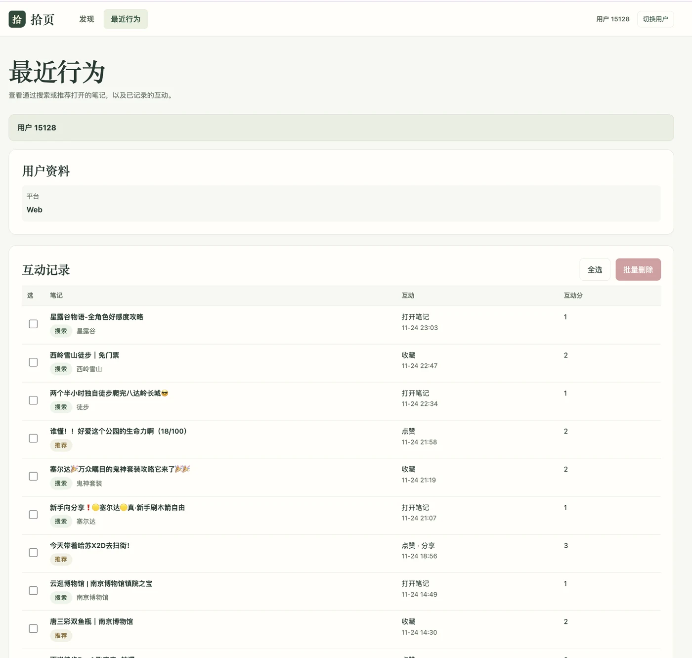

# 拾页 —— 小红书场景搜推一体化系统

拾页 是一个面向"小红书搜索推荐一体化"场景的搜推系统，采用业界主流的三层架构：

- **离线层**：样本构建、特征生成、召回 / 粗排 / 精排训练、索引构建、部署产物发布
- **在线层**：FastAPI 服务、冷启动、多路召回、粗排、精排、实时行为写回
- **前端层**：Vue 3 + Vite 可视化界面，覆盖搜索、推荐、笔记详情和最近行为

项目的目标不是做一个模型脚本集合，而是把 **离线训练 → 在线部署 → 页面验证 → 指标回放** 串成完整闭环，并保证在线链路具备生产级的低延迟表现。

> **数据说明**：训练与评测数据来自公开数据集 **Qilin**（小红书 × 清华大学，SIGIR 2025），不随仓库提供。获取与放置方式见 [5.2 数据获取](#52-数据获取公开数据集)。

---

## 界面预览

| 发现页 | 搜索结果 |
| --- | --- |
|  |  |

| 话题与个性化推荐 | 最近行为与互动 |
| --- | --- |
|  |  |

> 界面覆盖搜索、推荐、笔记详情与行为记录四条主路径；截图为演示环境效果。

---

## 1. 数据规模

数据来源于公开数据集 Qilin，规模如下：

| 项目 | 规模 |
| --- | ---: |
| 笔记总数 | 1,983,938（约 2M） |
| 用户总数 | 15,482 |

**搜索场景（Search）**

| 数据集 | 样本量 |
| --- | ---: |
| 训练集 | 44,024 |
| 测试集 | 6,192 |

特征包含 Query 元数据、用户交互日志、点击标签真值。

**推荐场景（Recommendation）**

| 数据集 | 样本量 |
| --- | ---: |
| 训练集 | 83,437 |
| 测试集 | 11,115 |

特征包含细粒度用户历史行为序列、候选笔记池、上下文特征、点击标签真值。

---

## 2. 效果指标

### 2.1 在线推理延迟

| 场景 | P50 | P95 | P99 |
| --- | ---: | ---: | ---: |
| 搜索 | 223.60 ms | 496.60 ms | 654.80 ms |
| 推荐 | 228.90 ms | 369.40 ms | 425.10 ms |

### 2.2 搜索场景离线指标

| 阶段 | 指标 | 数值 |
| --- | --- | ---: |
| 召回（6,192 条测试请求） | HitRate@10 | **55.23%** |
| | Recall@100 | **63.71%** |
| | MRR@100 | 0.29 |
| 排序（128,191 条测试曝光） | NDCG@10 | **0.55** |
| | AUC | 0.58 |
| | GAUC | 0.57 |

### 2.3 推荐场景离线指标

| 阶段 | 指标 | 数值 |
| --- | --- | ---: |
| 召回（11,115 条测试请求） | HitRate@50 | **6.61%** |
| | Recall@100 | **4.10%** |
| 排序（182,567 条测试曝光） | NDCG@10 | **0.62** |
| | AUC | 0.61 |
| | GAUC | 0.62 |

> **术语说明**：「测试请求」指一次搜索或推荐请求；「测试曝光」指该请求中一条笔记的曝光记录。NDCG/AUC/GAUC 均按曝光粒度统计。

### 2.4 参考硬件配置

| 项 | 配置 |
| --- | --- |
| GPU | RTX 5070 Ti 32 GB |
| CPU | Ryzen 7 9700X（8 核） |
| 内存 | 32 GB |
| 存储 | 固态硬盘 ~500 GB |

内存是离线特征工程的瓶颈项，建议不低于 32 GB。

---

## 3. 系统架构

### 3.1 核心链路

```text
数据预处理 / 特征工程
  → 召回训练与索引构建
    → DSSM 双塔
    → Swing
    → UserCF
    → Faiss IVFPQ
    → 多路召回融合
  → 粗排训练
    → LambdaMART（LightGBM + XGBoost）
  → 精排训练
    → DIEN
  → 部署产物发布
  → FastAPI 在线服务
  → Vue 前端展示搜索、推荐及请求链路
```

### 3.2 离线训练链路

```bash
uv run python src/backend/offline/pipeline.py --scene search
uv run python src/backend/offline/pipeline.py --scene rec
```

离线流程分为五个阶段，可通过 `--only` 单独执行：

| 阶段 | 职责 |
| --- | --- |
| `data` | 构建 train / test 请求样本 |
| `feature` | 生成模型训练所需特征与 embedding |
| `training` | 训练召回、multiroute、粗排、精排 |
| `deploy` | 将离线产物发布到 `outputs/deploy/{scene}/{tag}` |
| `feature-upload` | 将用户画像与在线需要的实时特征写入 Redis |

```bash
# 只跑指定阶段
uv run python src/backend/offline/pipeline.py --scene search --only data,feature

# 只跑指定训练子阶段（recall / multiroute / preranking / ranking）
uv run python src/backend/offline/pipeline.py --scene rec --train recall,preranking
```

### 3.3 在线服务链路

融合链路在 `src/backend/online/pipeline.py` 中统一编排：

1. 解析用户与请求上下文
2. 冷启动判断（无历史行为时走热门兜底）
3. 多路召回
4. 粗排（GBDT，默认截断 Top 500）
5. 精排（DIEN）
6. 重排（去重 / 多样性）
7. 首页结果返回或详情页补查

```bash
uv run python src/backend/online/api/main.py --host 0.0.0.0 --port 18080 --tag hard
```

### 3.4 一键启动

```bash
./start.sh   # 校验依赖 → 构建前端 → 拉起后端（日志在 .qilin/log/）
./stop.sh    # 停止服务
```

启动脚本会自动处理 Redis 容器（`qilin-redis-local`）与前端构建产物，后端默认监听 `18080`，前端页面入口为 `/login`。

---

## 4. 模型分层

### 4.1 召回层

| 通路 | 说明 | 代码 |
| --- | --- | --- |
| DSSM ANN | 双塔向量召回，Faiss IVFPQ 索引 | `src/recall/dssm_trainer.py` |
| Swing | item-item 协同过滤 | `src/recall/build_swing_index.py` |
| UserCF | user-user 协同过滤 | `src/recall/build_usercf_index.py` |
| 序列转移 | 基于行为序列的转移召回 | `src/recall/build_seq_transition_index.py` |
| 多路融合 | 加权 / 学习式 / 上下文感知融合 | `src/recall/fusion.py`、`learned_context_fusion.py` |

搜索场景额外融合 request 级的 lexical / semantic 检索结果（`src/recall/lexical.py`、`query_encoding.py`）。

在线侧对应实现在 `src/backend/online/recall/`（`dssm.py`、`swing.py`、`usercf.py`、`service.py`）。

### 4.2 粗排层

采用 GBDT 路线，负责把召回候选从千级压缩到百级，利用 query / user / note / linkage 四类特征快速打分。

- 训练：`src/training/gbdt_ranker.py`
- 在线：`src/backend/online/preranking/gbdt.py`

### 4.3 精排层

采用 DIEN 路线，对用户兴趣做序列建模，在粗排候选上完成更精细的重排。

- 训练：`src/training/dien_ranker.py`
- 在线：`src/backend/online/ranking/dien.py`、`inference.py`

---

## 5. 项目结构

```text
.
├─ src/
│  ├─ preprocess/            # 样本构建、embedding 生成、特征工程、mmap 转换
│  ├─ recall/                # 召回训练与索引构建（DSSM / Swing / UserCF / Faiss）
│  ├─ training/              # 粗排 GBDT、精排 DIEN、loss、排序栈
│  ├─ backend/
│  │  ├─ offline/            # 五阶段离线调度、Redis 灌数、产物发布
│  │  └─ online/             # FastAPI 服务、冷启动、召回/粗排/精排、实时缓存
│  └─ frontend/              # Vue 3 + Vite + Storybook
├─ start.sh / stop.sh        # 一键启停
├─ docker-compose.yml        # API + 前端 + Redis + Elasticsearch
├─ pyproject.toml            # 依赖声明（uv）
└─ uv.lock                   # 版本锁定
```

### 5.1 数据与产物目录

代码运行依赖以下目录，其中 `datasets/` 与 `image/` 来自公开数据集（见 5.2），其余为离线流水线产物：

```text
datasets/                  # 原始数据
├─ user_feat/              # user_feat/train-00000-of-00001.parquet
├─ notes/                  # notes/train-*.parquet
├─ search_train/  search_test/
└─ recommendation_train/  recommendation_test/

features/                  # {scene}_{split}_features.parquet
embeddings/                # note_text_emb / note_image_emb / {scene}_query_emb
image/                     # 笔记图片（在线接口 /image/* 直接读取）
outputs/
├─ data/                   # 样本与召回候选
├─ index/                  # 向量索引
├─ models/                 # 训练产物
├─ deploy/{scene}/{tag}/   # 在线真正加载的 models + index + active_bundle.json
└─ serving_cache/{scene}/{tag}/  # 后端指标快照
```

### 5.2 数据获取（公开数据集）

训练与评测数据来自公开数据集 **Qilin**（小红书 × 清华大学，SIGIR 2025），可自由下载用于研究，无需额外授权。

| 资源 | 地址 |
| --- | --- |
| 数据文件（Parquet） | [HuggingFace · THUIR/qilin](https://huggingface.co/datasets/THUIR/qilin) |
| 笔记图片 | [清华云盘](https://cloud.tsinghua.edu.cn/d/af72ab5dbba1460da6c0/) ／ [百度网盘](https://pan.baidu.com/s/1OC098qc2seV_FQlEo5ZBlg?pwd=cyh6)（提取码 `cyh6`） |
| 官方仓库与基线 | [RED-Search/Qilin](https://github.com/RED-Search/Qilin) |
| 论文 | [arXiv:2503.00501](https://arxiv.org/abs/2503.00501) |

**下载数据文件**

```bash
pip install huggingface_hub
huggingface-cli download THUIR/qilin --repo-type dataset --local-dir ./qilin_raw
```

**按项目要求放置**

| 数据集子集 | 放置路径 |
| --- | --- |
| `search_train` | `datasets/search_train/train-00000-of-00001.parquet` |
| `search_test` | `datasets/search_test/train-00000-of-00001.parquet` |
| `recommendation_train` | `datasets/recommendation_train/train-00000-of-00001.parquet` |
| `recommendation_test` | `datasets/recommendation_test/train-00000-of-00001.parquet` |
| `notes` | `datasets/notes/train-*.parquet` |
| `user_feat` | `datasets/user_feat/train-00000-of-00001.parquet` |

> 子集名称以数据集页面标注为准；若文件名不同，按上表重命名即可，代码按目录名与 `train-*.parquet` 通配匹配。

**图片资源**：从清华云盘或百度网盘下载后解压至 `image/`，在线接口 `/image/*` 会按笔记图片相对路径直接读取。

**体积提示**：完整图片资源约 340 GB，数据文件约 1 GB。建议先用官方仓库提供的 `datasets/toy_data` 小样本验证链路，再跑全量训练。

---

## 6. 前端

技术栈：Vue 3 + Vite + TypeScript + Pinia + Vue Router + Storybook（MSW mock）。

```bash
cd src/frontend
npm ci
npm run dev        # 开发模式
npm run build      # 生产构建
npm run typecheck  # 类型检查
npm run storybook  # 组件文档（6006 端口）
```

页面路由：

| 路径 | 页面 |
| --- | --- |
| `/login` | 登录 / 用户选择 |
| `/` | 首页 feed（搜索 / 推荐双场景） |
| `/detail` | 笔记详情、互动与单条请求的排序链路 |
| `/user` | 最近行为与历史 |

后端接口共 19 个，覆盖 feed、note、behavior 写回、suggest、metrics、validation 与图片静态服务。

---

## 7. Redis 缓存设计

Key 规范：

| Key | 内容 |
| --- | --- |
| `qilin:user:{user_idx}:profile` | 用户画像缓存 |
| `qilin:user:{user_idx}:{scene}:requests` | 最近请求序列 |
| `qilin:user:{user_idx}:{scene}:history_notes` | 最近历史 note 序列 |
| `qilin:user:{user_idx}:{scene}:behaviors` | 最近行为事件流 |
| `qilin:user:{user_idx}:{scene}:exposed_notes` | 最近曝光 note |
| `qilin:{scene}:runtime_request_id` | 在线 request id 自增计数 |
| `qilin:dedup:*` | 行为去重窗口 |

**行为写入链路**：前端 `click / view / engage / deleteBehavior` → `src/backend/online/api/main.py` → `pipeline.py` → `realtime_cache.py` → Redis。写入后同步失效对应用户的服务缓存，保证下一次请求立即生效。

---

## 8. 部署产物与指标快照

在线服务实际加载：

```text
outputs/deploy/{scene}/{tag}/models
outputs/deploy/{scene}/{tag}/index
outputs/deploy/{scene}/{tag}/active_bundle.json
```

后端指标快照：

```text
outputs/serving_cache/{scene}/{tag}/
```

`{scene}` 取 `search` / `rec`，`{tag}` 取 `easy` / `hard`（对应不同规模与难度的候选配置）。

---

## 9. 环境要求

| 项 | 版本 |
| --- | --- |
| Python | 3.10 |
| Node.js | ≥ 20（前端构建） |
| Redis | ≥ 6 |
| 依赖管理 | uv（Python）、npm（前端） |

```bash
uv sync                              # 安装 Python 依赖
cd src/frontend && npm ci            # 安装前端依赖
```

---

## 10. 许可

本项目采用 [MIT License](./LICENSE) 开源协议。
